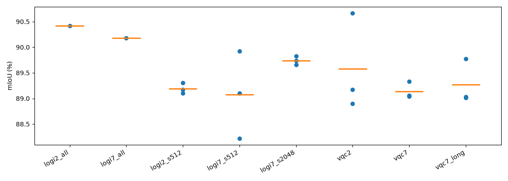
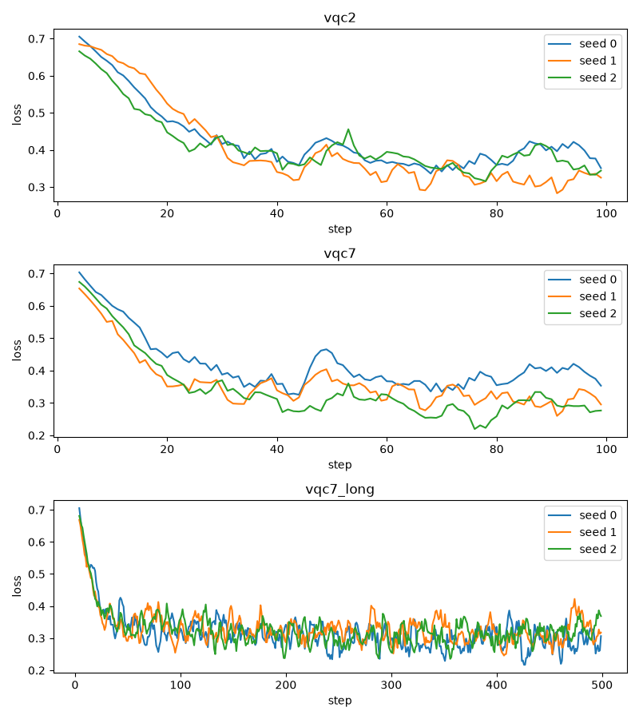

# Si 상 분류: 로지스틱 회귀와 변분 양자 분류기(VQC) 비교

2026 KoMaP AI 경진대회(고탄성 알루미늄 합금 미세조직 상 분할) 제출 모델은 Si로 분할한 영역마다 Primary Si인지
Eutectic Si인지를 로지스틱 회귀로 분류했습니다. 이 저장소는 같은 자리에 변분 양자 분류기(VQC, variational
quantum classifier)를 넣었을 때 분류 성능이 달라지는지를 같은 데이터·같은 지표로 비교합니다. 양자 회로는
시뮬레이터로 정확한 기댓값을 계산하며, 실제 양자 장치는 쓰지 않았습니다.

대회 제출 코드는 [komap2026-aluminum-phase-segmentation](https://github.com/jun8741-crypto/komap2026-aluminum-phase-segmentation)에 있습니다.

## 결과

| 조건 | 특징 수 | 학습 표본 | mIoU(%) | F1 | 학습 시간(초) |
|---|---:|---:|---:|---:|---:|
| 로지스틱, 전체 학습 데이터 | 2 | 54,095 | 90.41 | 0.698 | 0.01 |
| 로지스틱, 전체 학습 데이터(대회 모델) | 7 | 54,095 | 90.18 | 0.683 | 0.02 |
| 로지스틱, 균형 표본 512 | 2 | 512 | 89.19 ± 0.10 | 0.720 ± 0.006 | 0.00 |
| 로지스틱, 균형 표본 512 | 7 | 512 | 89.08 ± 0.85 | 0.705 ± 0.037 | 0.00 |
| 로지스틱, 균형 표본 2,048 | 7 | 2,048 | 89.74 ± 0.09 | 0.708 ± 0.023 | 0.00 |
| VQC 2큐비트, 100스텝 | 2 | 512 | 89.58 ± 0.95 | 0.659 ± 0.069 | 0.10 |
| VQC 7큐비트, 100스텝 | 7 | 512 | 89.14 ± 0.16 | 0.719 ± 0.007 | 1.39 |
| VQC 7큐비트, 500스텝 | 7 | 2,048 | 89.27 ± 0.43 | 0.720 ± 0.005 | 6.92 |

± 뒤는 시드 3개(0, 1, 2)의 표본표준편차입니다. 균형 표본은 Primary와 Eutectic을 같은 수로 뽑은 학습 표본이고,
같은 시드라면 로지스틱과 VQC가 똑같은 표본으로 학습합니다. 평가 데이터의 Si 영역을 모두 Eutectic이라고 예측하면
mIoU는 19.31%, 정확도는 94.27%입니다.



**판정.** 같은 시드끼리 짝지은 mIoU 차이를 보고, 차이의 평균이 그 차이의 시드 표준편차의 2배를 넘으면서 세 시드
모두 방향이 같을 때만 차이로 봤습니다.

- 같은 표본으로 학습한 로지스틱과 VQC는 세 쌍 모두 차이가 시드 간 변동 안에 있었습니다. mIoU 차이는 VQC 2큐비트가
  로지스틱 2특징·표본 512보다 +0.39%p, VQC 7큐비트가 로지스틱 7특징·표본 512보다 +0.06%p, VQC 7큐비트 500스텝이
  로지스틱 7특징·표본 2,048보다 −0.47%p입니다.
- 전체 학습 데이터로 학습한 대회 모델(로지스틱 7특징)과 비교하면 VQC 7큐비트가 1.04%p, VQC 7큐비트 500스텝이
  0.91%p 낮았고, 세 시드 모두 VQC가 낮았습니다. 이 비교는 모델 종류와 학습 데이터 양(54,095 대 512·2,048)이 함께
  다릅니다.
- VQC 7큐비트는 VQC 2큐비트보다 0.44%p 낮았고, VQC 7큐비트 500스텝(표본 2,048)은 VQC 7큐비트 100스텝(표본 512)보다
  0.13%p 높았습니다. 둘 다 시드 간 변동 안이었고, 두 비교 모두 여러 조건(큐비트와 특징 수, 스텝과 표본 수)이 함께
  바뀌어 한 요인의 효과로 나눌 수 없습니다.

정리하면 이 데이터에서 VQC는 같은 표본의 로지스틱 회귀와 구별되는 이득을 보이지 않았습니다. 로지스틱 회귀만
놓고 보면 특징 7개(90.18%)가 특징 2개(90.41%)보다 높지 않았습니다(전체 학습 데이터 기준).



## 비교 방법

**데이터.** 대회 학습·검증 이미지 90장에서 3클래스 분할 모델이 Si로 예측한 픽셀을 서로 이어진 영역(connected
component)으로 묶고, 영역마다 특징 7개와 정답을 계산한 표입니다(`data/si_blob_features.csv.gz`, 103,235행).

| 특징 | 뜻 |
|---|---|
| `p_primary` | 영역 안 Primary 확률 평균 ÷ (Primary 확률 평균 + Eutectic 확률 평균), Si 보조 모델 출력 |
| `p_si3` | 영역 안 3클래스 분할 모델의 Si 확률 평균 |
| `norm_thickness` | 영역 두께(경계까지 거리의 최댓값 × 2) ÷ 이미지 폭에 비례하는 기준값 |
| `log_area` | log(1 + 영역 면적(픽셀 수)) |
| `elongation` | 면적 ÷ 두께². 같은 두께라면 길쭉할수록 크다 |
| `thickness_std` | 영역 안 픽셀에서 경계까지 거리의 표준편차 × 2 |
| `perimeter_ratio` | 경계 픽셀 수 ÷ 면적 |

2특징 조건은 `p_primary`, `p_si3` 두 개만 씁니다.

**분할.** 평가 데이터는 대회 검증 이미지 20장(이하 평가 이미지)의 Si 영역 22,788개(정답이 있는 16,707개)입니다. 학습 데이터는 학습
이미지 70장 가운데 평가 이미지와 합금이 겹치는 7종(9장)을 뺀 61장이고, 정답이 있는 영역은 54,095개입니다.
합금 단위로 나눈 이유는 같은 합금의 이미지가 양쪽에 들어가 점수가 과대평가되지 않게 하기 위해서입니다.

**지표.** 주 지표는 Si 영역 안 정답 픽셀로 계산한 Primary·Eutectic 두 클래스 IoU의 평균(mIoU)입니다.
Primary는 학습 데이터에서 정답이 있는 영역 수로는 6.8%(3,702/54,095)뿐이지만 정답 픽셀 수로는 63.1%라서, 영역 단위 정확도는 모두 Eutectic이라고
답해도 94%가 나옵니다. 보조 지표 F1은 Primary를 양성으로 둔 영역 단위 값입니다.

**분류 임계값.** 모든 조건이 같은 규칙을 씁니다. 학습 분할에서 무작위로 뽑은 영역 5,000개에서 픽셀 mIoU가
가장 높은 확률 임계값(0.05~0.95, 0.01 간격)을 고르고, 평가 데이터에는 그 값을 그대로 씁니다.

**VQC 회로.** 큐비트 q가 특징 q를 받는 재업로딩(data re-uploading) 회로입니다. 층마다 다음을 2번 반복합니다.

1. 입력 인코딩: 큐비트마다 RY(x_q). 특징은 학습 표본으로 표준화한 뒤 ±3으로 자릅니다.
2. 학습 회전: 큐비트마다 RY(w), RZ(w).
3. 얽힘: CNOT(0→1), CNOT(1→2), … 사슬.

큐비트마다 Z 기댓값 ⟨Z_q⟩를 재고, 선형 층 하나가 이를 로짓 Σ c_q⟨Z_q⟩ + b로 합칩니다. 7큐비트면 회로 각도
28개와 선형 층 8개, 합계 36개 매개변수를 학습합니다. 손실은 이진 교차엔트로피, 최적화는 Adam(학습률 0.05),
미니배치는 64입니다.

## 구현

7큐비트 VQC를 qiskit-machine-learning의 `EstimatorQNN`과 매개변수 이동 규칙(parameter-shift rule)으로
학습하면 미니배치 한 스텝에 29.8초가 걸렸습니다(2026-11-12, Apple M 계열 CPU에서 측정). 각도 하나의 기울기마다 회로를 두 번씩 더
계산하기 때문입니다. 이 저장소는 상태벡터를 torch로 직접 계산하고(`src/qsi/simulator.py`) 자동미분으로
기울기를 구해, 7큐비트 100스텝 학습이 평균 1.39초에 끝납니다(`results/runs.csv`). 시드 3개씩 8개 조건 전체 실행은
41초 걸렸습니다(2026-11-17, 같은 기기, 데이터 로드와 그림 포함).

qiskit 경로는 참값으로 남겨 두었고(`VQCModel(backend="qiskit")`), 두 경로가 같은 값을 내는지 테스트로 확인합니다.

- 상태벡터의 복소 진폭이 qiskit `Statevector`와 1e-10 안에서 같습니다(2·3·4·7큐비트, 층 수·입력 배율을 바꿔도).
- 회로 각도에 대한 기울기가 중앙 유한차분과 1e-6 안에서 같습니다(2·7큐비트). 2큐비트에서는 `EstimatorQNN`의
  매개변수 이동 기울기와도 1e-8 안에서 같습니다.
- 2큐비트 VQC를 두 경로로 10스텝 학습하면 스텝별 손실 차이가 1e-4 미만입니다(테스트).
- 테스트 밖에서 2큐비트 시드 0을 100스텝 끝까지 두 경로로 따로 학습해 보니, 두 경로 모두 mIoU 90.667%, F1 0.674,
  임계값 0.95였습니다. 학습·임계값 선택·평가 예측을 합친 실행 시간은 qiskit 경로 75초, torch 경로 1초 미만이었습니다
  (2026-11-17 측정).
  `--conditions vqc2 --seeds 0 --backend qiskit`으로 재현할 수 있습니다.

qiskit-machine-learning 0.9.0의 `EstimatorQNN`은 기본값으로 기댓값에 표준편차 0.015625의 잡음을 섞으므로
qiskit 경로에는 `default_precision=0.0`을 지정했습니다.

**측정 횟수의 영향.** 실제 양자 장치는 측정을 반복한 평균으로 기댓값을 추정합니다. 학습한 VQC 7큐비트(시드 0)를
평가 영역 2,000개에서 측정 횟수(샷)를 바꿔 다시 예측했습니다.

| 샷 | 확률 평균 절대오차 | 예측이 바뀐 영역 | mIoU(%) |
|---:|---:|---:|---:|
| 32 | 0.102 | 8.45% | 81.95 |
| 128 | 0.050 | 1.65% | 84.18 |
| 512 | 0.024 | 0.40% | 84.49 |
| 2,048 | 0.013 | 0.15% | 85.21 |
| 8,192 | 0.006 | 0.10% | 85.16 |

정확한 기댓값으로 예측한 같은 2,000개의 mIoU는 85.17%입니다. 예측이 바뀐 영역은 2,048샷에서 0.15%, 8,192샷에서
0.10%였습니다.

## 실행

```bash
uv venv --python 3.12 .venv
uv pip install --python .venv/bin/python -r requirements.txt

.venv/bin/python -m pytest -q                       # 테스트 22개(2026-11-17 측정 13초)
PYTHONPATH=src .venv/bin/python -m qsi.cli          # 전체 실험, 결과는 results/
PYTHONPATH=src .venv/bin/python -m qsi.cli --conditions logi7_all,vqc7 --seeds 0,1,2
PYTHONPATH=src .venv/bin/python -m qsi.cli --conditions vqc2 --seeds 0 --backend qiskit   # qiskit 참값 경로
```

`results/`에는 시드별 결과(`runs.csv`), 조건별 요약(`summary.csv`, `summary.md`), 그림 두 장, 샷 분석(`shots.csv`)이
생깁니다.

## 구성

```
src/qsi/
  config.py      경로·특징·조건 8개·하이퍼파라미터(단일 정의)
  io.py          데이터 로드, 합금 단위 분할, 균형 표본, 임계값 집합
  metrics.py     픽셀 IoU, 영역 F1, 임계값 선택
  circuits.py    qiskit 회로와 관측량(참값 경로)
  simulator.py   torch 상태벡터 시뮬레이터, 샷 샘플링
  models.py      VQCModel(torch/qiskit), 로지스틱 회귀
  experiment.py  조건 실행, 요약, 짝지은 판정
  report.py      표와 그림
  cli.py         진입점
tests/           22개
data/            Si 영역 특징표(gzip)
```

데이터는 대회 학습·검증 이미지와 정답 마스크에서 계산한 Si 영역별 특징값과 정답 라벨 표입니다. 이미지와 마스크 원본은 들어 있지 않으며, 비상업 학습 목적으로 공개합니다.
